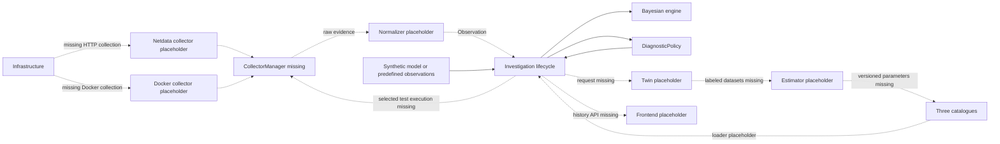
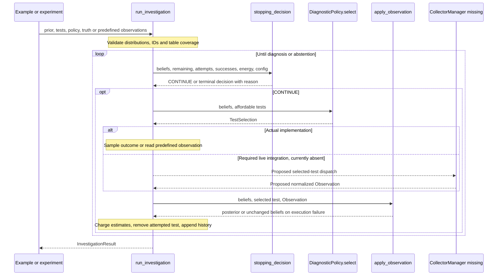

# InfraSage codebase audit and development roadmap

Audit date: 2026-11-14. Scope: the existing working tree, including uncommitted catalogue and documentation changes. This report is based on source inspection, not the architecture diagrams alone. No application source or dependency environment was modified during the audit.

## Table of contents

1. [Executive findings](#1-executive-findings)
2. [Annotated repository inventory](#2-annotated-repository-inventory)
3. [Implemented contracts and dependencies](#3-implemented-contracts-and-dependencies)
4. [Mathematical engine](#4-mathematical-engine)
5. [Collectors and normalization](#5-collectors-and-normalization)
6. [Investigation lifecycle](#6-investigation-lifecycle)
7. [Catalogue audit](#7-catalogue-audit)
8. [Communication and architecture](#8-communication-and-architecture)
9. [Digital twin](#9-digital-twin)
10. [Tests and operational readiness](#10-tests-and-operational-readiness)
11. [Development status dashboard](#11-development-status-dashboard)
12. [Ranked integration gaps](#12-ranked-integration-gaps)
13. [Implementation roadmap](#13-implementation-roadmap)
14. [Final recommendations and first success criterion](#14-final-recommendations-and-first-success-criterion)

## 1. Executive findings

**InfraSage currently runs a tested, infrastructure-independent Bayesian diagnosis simulation. It does not yet run a live infrastructure investigation.** Preserve the mathematical implementation and connect real evidence to it.

- `backend/core/models.py`, `backend/diagnosis/bayesian.py`, `backend/optimization/planner.py`, and `backend/core/orchestrator.py` implement validated contracts, Bayesian updates, four greedy policies, stopping rules, and an in-memory investigation trace.
- `run_investigation()` samples synthetic observations or consumes a preassembled mapping of observations. It never invokes a collector. Predefined observations are useful replay input, not live execution.
- All collector files, the normalizer, catalogue loader, probability estimator, energy meter, twin manager, API routes, application entry point, frontend files, and laboratory Compose file are **zero-byte placeholders**. No `NetdataCollector`, `DockerCollector`, `BaseCollector`, `CollectorManager`, or `CollectionOrchestrator` class exists.
- Three substantial catalogue files define 15 hypotheses, 20 tests, and 300 likelihood distributions. Their numbers are synthetic; all 20 tests disable live execution and have null execution bindings.
- Existing tests passed during this audit: **65 passed in 4.44 seconds**, Python 3.12.3. These tests verify mathematics and simulated/replayed investigations, not Netdata, Docker, a deployed Voting App, or a twin.
- `scripts/validate_catalogues.py` could not start: `ModuleNotFoundError: No module named 'yaml'`. PyYAML is undeclared in `requirements.txt`. No dependency was installed. A separate inspection-time check validated extracted outcome vocabularies and all numerical distributions through the existing `DiagnosticTest` constructor; this does not substitute for running the YAML validator.

The shortest route to V0.1 is a small Redis investigation with three hypotheses, two executable tests, one CollectorManager, one normalizer, and the existing lifecycle/math functions. A frontend and online twin validation need not block that first CLI demonstration.

## 2. Annotated repository inventory

The tree below includes relevant existing source, configuration, assets, and artifact directories. Generated Python caches, pytest caches, virtual-environment packages, and Git internals are omitted. Every package `__init__.py` shown is empty; these establish packages, not functional components.

```text
.
├── .env.example                         empty; no configuration template
├── .gitignore                           ignores venv/Python/pytest caches
├── README.md                            mathematical prototype usage and assumptions
├── requirements.txt                     pytest>=8.0,<10 only
├── mermaid-diagram(3).png                intended investigation/collector/twin flow
├── backend/
│   ├── __init__.py                      empty
│   ├── main.py                          empty; no runnable application/server
│   ├── api/
│   │   ├── __init__.py                   empty
│   │   └── routes.py                    empty; no HTTP routes
│   ├── collectors/
│   │   ├── __init__.py                   empty
│   │   ├── base.py                      empty; no BaseCollector
│   │   ├── docker.py                    empty; no DockerCollector
│   │   └── netdata.py                   empty; no NetdataCollector
│   ├── core/
│   │   ├── __init__.py                   empty
│   │   ├── models.py                    validated dataclasses/enums
│   │   └── orchestrator.py              synchronous simulated/replay loop
│   ├── diagnosis/
│   │   ├── __init__.py                   empty
│   │   ├── bayesian.py                  posterior, entropy, expected IG
│   │   ├── example.py                   four-hypothesis synthetic model/CLI
│   │   ├── catalogue_loader.py          empty
│   │   ├── probability_estimator.py     empty
│   │   ├── mermaid-diagram(2).png        mathematical simulation diagram
│   │   ├── catalogues/
│   │   │   ├── knowledge.yaml           candidate causes/qualitative relations
│   │   │   ├── tests.yaml               proposed operations, outcomes, costs
│   │   │   └── probabilities.json       synthetic priors/likelihoods
│   │   └── generated/
│   │       └── netdata_capabilities.example.json  undiscovered empty inventory
│   ├── optimization/
│   │   ├── __init__.py                   empty
│   │   └── planner.py                   four deterministic selection policies
│   ├── processing/
│   │   ├── __init__.py                   empty
│   │   └── normalizer.py                empty
│   ├── energy/
│   │   ├── __init__.py                   empty
│   │   └── meter.py                     empty
│   └── twin/
│       ├── __init__.py                   empty
│       └── manager.py                   empty
├── frontend/
│   ├── package.json                     empty; invalid package manifest
│   └── src/App.tsx                      empty; no UI
├── lab/compose.yaml                     empty; no deployment topology
├── experiments/
│   ├── compare_policies.py              paired Monte Carlo/stress validation
│   ├── validation_results.json          saved synthetic results/models
│   ├── VALIDATION.md                    historical numerical validation report
│   ├── VALIDATION_COMMANDS.md           historical commands and checks
│   ├── data/.gitkeep                    empty; no labeled live dataset
│   └── scenarios/.gitkeep               empty; no fault scenarios
├── scripts/
│   ├── validate_catalogues.py           structural/numeric catalogue checks
│   ├── demo_planner.py                  separate synthetic IG/J ranking demo
│   └── import_prometheus_candidates.py  local upstream candidate importer
├── tests/
│   ├── .gitkeep                         empty
│   ├── test_engine.py                   math/contracts/policies/runner tests
│   └── test_validation.py               independent references/stress tests
└── docs/
    ├── IMPLEMENTATION_NOTES.md          proposed component contracts/vertical slice
    ├── SOURCE_MANIFEST.json             counts and source/provenance disclaimers
    ├── InfraSage_Collectors_Catalogues_and_Bayesian_Strategy.pdf  design note
    └── INFRASAGE_CODEBASE_AUDIT.md       this audit
```

The PDF explicitly describes an agreed direction, not implemented integration. Both PNGs were visually inspected: one depicts the intended collector/twin loop, the other explicitly uses a simulated observation. Neither provides executable functionality. No extra collector coordinator or application implementation was found elsewhere in the relevant tree.

## 3. Implemented contracts and dependencies

### 3.1 Important Python files

| File and symbols | Inputs → outputs | Imports/dependencies | Status and connections |
|---|---|---|---|
| `backend/core/models.py`: `validate_distribution`, `validate_cost` | symbolic probability map or scalar → validation/exception | dataclasses, datetime, enum.StrEnum, math, typing | Used by inference, policy, runner, experiments; no external runtime dependency |
| Same: `Hypothesis` | identifier/description → frozen dataclass | standard library | Defined but not used by the current synthetic model, which keys beliefs with strings |
| Same: `DiagnosticTest` | ID, outcome tuple, hypothesis→outcome table, estimated J/s → validated test | standard library | Core inference/planner object; execution bindings are absent from this model |
| Same: `Observation`, `ExecutionStatus` | test/target IDs, completed/failed/unavailable status, optional outcome, duration, optional measured energy, timestamp → observation | standard library | Consumed by `apply_observation`; current observations originate from Python construction/simulation |
| Same: `BeliefState`, `TestSelection`, `Decision`, `InvestigationResult` | posterior, selection and lifecycle data → records | standard library | In-memory history/result; no persistence or API serialization layer |
| `backend/diagnosis/bayesian.py`: `_validate`, `bayesian_update`, `apply_observation`, `entropy`, `expected_information_gain` | belief/test/outcome → posterior or bits | math; core models | Implemented/tested; no catalogue parsing or infrastructure access |
| `backend/optimization/planner.py`: `DiagnosticPolicy.__post_init__`, `.select` | belief and supplied candidate tests → `TestSelection` | dataclasses, typing; models; Bayesian IG | Implemented/tested; trusts caller to filter availability and affordability |
| `backend/core/orchestrator.py`: `StoppingConfig`, `stopping_decision`, `run_investigation` | model, policy, simulated truth or predefined observations → `InvestigationResult` | dataclasses, datetime, random, collections.abc; models, Bayes, policy | Implemented/tested for simulation/replay; no executor callback, collection batch, incident object, twin, or persistence |
| `backend/diagnosis/example.py`: `synthetic_model` | no arguments → prior dictionary and four tests | core models; CLI imports runner/policy/json | Functional demo, disconnected from all three catalogues |
| `experiments/compare_policies.py`: `ExperimentModel`, `Incident`, `experiment_model`, `_draw`, `generate_incidents` | scenario/count/seed → labeled synthetic observations | argparse, collections, copy, dataclasses, datetime, hashlib, json, math, pathlib, random; engine | Simulation truth is separate from assumed inference parameters; no fault injection |
| Same: `brier_score`, `reliability_bins`, `summarize`, `evaluate`, `compare`, `main` | incident/result sequences → metrics/CLI/optional JSON | same | Numerical experiment suite; does not calibrate or export learned likelihoods |
| `scripts/validate_catalogues.py`: `validate(base=BASE)` | three catalogue files → parsed `(knowledge, tests, model)` or SystemExit | pathlib, json, math, sys, **yaml** | Implemented but cannot run in available environment; not a production loader |
| `scripts/demo_planner.py`: `entropy`, `information_gain` | validator dictionaries → eight highest synthetic IG/J rankings | sibling `validate_catalogues`, math | Duplicates toy ranking math; never constructs engine objects or executes tests; blocked by yaml dependency |
| `scripts/import_prometheus_candidates.py`: `main` | local upstream rules file, output path, revision → candidate JSON | argparse, datetime, hashlib, json, pathlib, **yaml** | Implemented, untested here; no upstream checkout/input or generated candidate artifact present |

The importer expects upstream `groups[].services[].exporters[].rules[]`, filters service names using `MATCH`, and preserves query text, description, severity, duration, revision, SHA256, import time, and origin. It labels entries `candidate_only`, `is_root_cause=false`, and `netdata_executable=false`. It does not fetch sources, register tests, or derive probabilities. Its default revision is `unrecorded`; provenance is incomplete unless supplied. License/review mapping must be added when actual content is imported.

### 3.2 Actual method signatures

```python
# backend/diagnosis/bayesian.py
bayesian_update(prior: dict[str, float], test: DiagnosticTest,
                observed_outcome: str) -> dict[str, float]
apply_observation(prior: dict[str, float], test: DiagnosticTest,
                  observation: Observation) -> dict[str, float]
entropy(beliefs: dict[str, float]) -> float
expected_information_gain(beliefs: dict[str, float], test: DiagnosticTest) -> float

# backend/optimization/planner.py, DiagnosticPolicy
select(self, beliefs: dict[str, float],
       tests: Sequence[DiagnosticTest]) -> TestSelection

# backend/core/orchestrator.py
stopping_decision(beliefs: dict[str, float], remaining: Sequence[DiagnosticTest],
                  attempts: int, successes: int, energy: float,
                  config: StoppingConfig) -> tuple[Decision, str]
run_investigation(initial_beliefs: dict[str, float], tests: Sequence[DiagnosticTest],
                  policy: DiagnosticPolicy, ground_truth: str | None = None,
                  seed: int = 0, stopping: StoppingConfig | None = None,
                  predefined_observations: Mapping[str, Observation] | None = None,
                  target_identifier: str = 'synthetic-voting-app') -> InvestigationResult
```

`Observation` fields are `test_identifier`, `target_identifier`, `execution_status`, `observed_outcome=None`, `duration_seconds=0.0`, `measured_energy_joules=None`, and a default UTC `timestamp`. `InvestigationResult` contains decision/reason/diagnosed hypothesis, final beliefs, belief history, observations, selections, total estimated energy and estimated latency. It has no investigation ID or model version.

Frozen dataclasses contain mutable dictionaries: freezing does not make likelihoods/beliefs deeply immutable. Public inference boundaries revalidate test tables. Observation construction validates status/outcome presence and nonnegative finite costs, but does not enforce nonempty IDs, timestamp timezone/type/freshness, or outcome vocabulary against a particular test. The latter is checked when completed observations reach Bayes. Target checking exists in predefined runner mode, not in `apply_observation` alone.

## 4. Mathematical engine

### 4.1 Representation and assumptions

Beliefs are finite maps `dict[str, float]`; every test must have exactly the same hypothesis keys. Each likelihood row must cover every declared outcome. Distributions must sum to one within absolute tolerance `1e-9`; invalid input is rejected rather than silently normalized (`models.validate_distribution`, `DiagnosticTest.__post_init__`, `bayesian._validate`).

The current example uses mutually exclusive single initiating causes: `worker_stopped=.35`, `redis_unavailable=.30`, `database_unavailable=.25`, `other_unknown=.10`. Tests are `check_worker_state`, `check_redis_connectivity`, `check_database_connectivity`, and the four-outcome `check_application_workflow`. Estimated energies are 1, 2, 3, 12 J; latencies .1, .3, .5, 2 seconds. These are illustrative constants (`example.synthetic_model`), not measurements or catalogue parameters.

The catalogue's 15-cause model is separate. Sequential evidence is assumed conditionally independent given the initiating cause and selected test. Multiple simultaneous faults, temporal transitions, dependent evidence and uncertain parameters are not explicitly modeled. A zero-prior cause can never regain mass through ordinary Bayesian updates (`test_impossible_and_zero_prior_cannot_recover`).

### 4.2 Implemented equations

For belief \(b(h)\), test \(t\), supported outcome \(o\), and likelihood \(L_t(o\mid h)\):

\[
P(o\mid b,t)=\sum_h b(h)L_t(o\mid h),\qquad
b'(h)=\frac{b(h)L_t(o\mid h)}{\sum_j b(j)L_t(o\mid j)}.
\]

`bayesian_update()` computes positive weights in log space, subtracts the maximum log weight, exponentiates, and normalizes with `math.fsum`. Unsupported outcomes and zero predictive probability raise `ValueError`. Priors are not mutated. Extreme posterior terms can still underflow to zero; log weighting is numerical protection, not arbitrary-precision inference.

\[
\mathcal H(b)=-\sum_{h:b(h)>0}b(h)\log_2 b(h),\qquad
IG(b,t)=\mathcal H(b)-\sum_{o:P(o)>0}P(o\mid b,t)\mathcal H(b^{t,o}).
\]

`entropy()` uses bits, omitting zero terms. `expected_information_gain()` enumerates discrete outcomes, skips impossible predictive outcomes, rejects gain below `-1e-9`, and clamps smaller negative roundoff to zero. An individual surprising observation may increase entropy even though expected gain is nonnegative; the independent tests cover that distinction.

### 4.3 Selection policies

`DiagnosticPolicy(method='information_gain', fixed_order=(), lambda_energy=0, lambda_latency=0)` supports:

| Policy | Actual score/ordering | Limitations |
|---|---|---|
| `fixed` | negative index in `fixed_order` | Every supplied candidate must appear; still computes IG metadata |
| `information_gain` | maximize \(IG(b,t)\) | Ignores energy and latency in ranking |
| `ratio` | maximize \(IG(b,t)/E_t\) for positive energy | Informative zero-energy tests get explicit priority, `score=None`, `zero_cost_priority=True`; uninformative free tests score zero |
| `weighted` | maximize \(IG(b,t)-\lambda_EE_t-\lambda_LL_t\) | Weights are nonnegative bits/J and bits/s; negative best scores are not themselves a stopping criterion |

Ties use test identifier lexicographic order, including ties among free informative tests. The planner does not discover available tests, execute them, enforce budgets, optimize a full future decision tree, or learn costs. The runner filters affordable candidates first. The insufficient-information stop checks whether **all** affordable tests have negligible IG; it does not necessarily exclude each individually uninformative test before a fixed policy selects.

### 4.4 Stopping, failure and unknown handling

`StoppingConfig` defaults: confidence .95, at most four attempts, estimated budget 100 J, minimum IG `1e-12` bits, at least one completed observation. `stopping_decision()` checks in this order:

1. Sufficient successful observations and leader confidence at threshold: diagnose a known leader, or abstain if leader ID is exactly `other_unknown`.
2. Attempt limit reached: abstain.
3. No remaining tests: abstain.
4. No affordable remaining test: abstain for energy budget.
5. Every affordable test has IG at/below minimum: abstain for insufficient evidence.
6. Otherwise continue.

Diagnosis takes precedence after the last affordable attempt. Unknown leadership below threshold may continue. A differently named unknown category receives no special treatment. This is explicit finite-model unknown handling, not automatic novelty detection.

`apply_observation()` checks test identity and returns an unchanged copy of beliefs for FAILED/UNAVAILABLE observations. A completed unhealthy outcome is evidence, not execution failure. Every attempted test is removed, even after failure, and its full estimated energy/latency is charged. No retries or failure likelihoods exist. Optional measured joules and actual duration do not affect estimated budget accounting. There is no latency budget, wall-clock deadline, cancellation, or exception-to-observation conversion.

### 4.5 Numerical validation versus operational accuracy

`tests/test_validation.py` independently checks exact Fraction posteriors, sequential likelihood products, direct mutual-information calculations over 60 rational random models, correlation overconfidence, threshold boundaries, strict JSON free-test selections, and exhaustive enumeration of the example's 32 potential outcome vectors across four policies and two budgets. This is strong evidence for finite-model computation under its assumptions.

`experiments.compare_policies` separates true and assumed models and pre-samples all potential test outcomes per incident. Policies/budgets within a scenario consume paired observations, identified by SHA256 fingerprints. Scenarios are matched, wrong prior, zero prior, likelihood mismatch, 20% outcome corruption, shared-quantile correlation, and an out-of-catalogue fault that mimics Redis. None uses a running application.

Saved `experiments/validation_results.json` contains 56 rows representing 56,000 policy investigations (7 scenarios × 2 budgets × 4 policies × 1,000 incidents). This audit parsed the JSON and rechecked count ordering, overall-accuracy arithmetic and termination counts. It did not rerun that full historical workload. A fresh reduced suite ran all 56 combinations with 12 incidents each: 672 simulated policy investigations, exit 0.

Historical matched/100 J results: ratio overall accuracy .868, diagnosed accuracy about .963, abstention .099, total estimated 7479 J; IG overall .794, diagnosed accuracy about .999, abstention .205, estimated 14709 J (`VALIDATION.md`, backed by saved JSON). These compare toy policies, not real monitoring accuracy or measured energy savings. The noisy scenario and novelty mimic demonstrate confident errors. Brier score is \(\sum_h(p_h-1[h=y])^2\); reliability bins assess top-label calibration across all terminal cases, and ECE weights confidence–accuracy gaps by bin population. External truths map to `other_unknown` only for Brier/reliability; a known diagnosis of such a fault remains wrong. Energy per correct diagnosis includes energy spent on all incidents, including abstentions.

## 5. Collectors and normalization

| Requested question | Verified answer |
|---|---|
| Metrics collected now | None; `collectors/base.py`, `docker.py`, `netdata.py` are empty |
| Synchronous/asynchronous collection | Neither implemented; only the mathematical runner is synchronous |
| Collector errors | No collector-level handling; engine contracts distinguish FAILED/UNAVAILABLE |
| Infrastructure snapshot | No snapshot class, dictionary schema, return structure, or producer exists |
| Netdata API communication | No client, URL, request, discovery, authentication, timeout, or test exists |
| Individual diagnostic execution | Missing; no collector method signatures exist |
| Planner-selected execution | Missing; runner consumes sampled/predefined observations |
| Docker-only data currently available | None. Container metadata, namespaces, endpoint configuration and bounded logs are proposed capabilities, not existing outputs |
| Output normalization | Missing; `processing/normalizer.py` is empty |
| Collector coordination | No manager or CollectionOrchestrator implementation exists |

`README.md` proposes an `ObservationCollector(Protocol)` with `execute(self, test: DiagnosticTest, target_identifier: str) -> Observation`. That interface appears only in a documentation snippet. `docs/IMPLEMENTATION_NOTES.md` proposes manager snapshot/test execution and collector methods, but these are not callable APIs.

Retain one lightweight CollectorManager for batch collection, capability routing, named test dispatch, bounded execution and error translation. All selection, posterior updates, budgets and lifecycle decisions belong to the existing investigation layer. There is no working CollectionOrchestrator to retain or rename in this checkout. If another branch later supplies one, retain its collection/routing code if compatible and remove diagnostic decision ownership rather than rebuilding its functioning providers.

Netdata catalogue candidates concern container state, Redis/PostgreSQL health, host CPU/memory/disk pressure, HTTP health, restart activity and database connections. They specify logical operations, not chart IDs, concrete API requests, units, aggregation windows or thresholds. Precision candidates concern worker/client-view connectivity, endpoint checks, bounded logs and a sandbox workflow. Docker is a possible supplementary execution mechanism, but no actual provider fallback registry exists, and tests currently declare only `netdata` or `precision`.

## 6. Investigation lifecycle

Classification applies to the real intended lifecycle; implemented simulation functions are identified separately.

| Step | Status | Evidence and integration gap |
|---|---|---|
| 1. Incident detection | Missing | No alert ingestion, polling, trigger or incident schema; routes/main empty |
| 2. Initial batch collection | Placeholder | Collector files empty; runner has no initial snapshot input |
| 3. Load candidate hypotheses | Placeholder | `catalogue_loader.py` empty; example constructs four string-keyed causes |
| 4. Load diagnostic definitions | Partially implemented | Script reads YAML dictionaries, blocked by yaml dependency; runtime object loader absent |
| 5. Raw metrics → observations | Placeholder | `normalizer.py` empty; observations constructed directly in Python |
| 6. Posterior updates | Implemented and tested | `bayesian_update`, `apply_observation`; no live source |
| 7. Planner call | Implemented and tested | `run_investigation` calls `DiagnosticPolicy.select` after energy filtering |
| 8. Execute selected diagnostic | Simulated or mocked | RNG sampling or predefined mapping; no collector invoked |
| 9. Repeat cycle | Implemented and tested | Bounded loop for simulation/replay; live dispatch missing |
| 10. Diagnosis/abstention/budget | Implemented and tested | `stopping_decision`; predicted energy and attempt limits only |
| 11. Twin validation request | Placeholder | `twin/manager.py` empty; no request/result interface |
| 12. History and persistence | Partially implemented | Result contains in-memory snapshots/observations/selections; durable storage absent |

There is no `InvestigationOrchestrator` class, but `core/orchestrator.py` is already the correct location for lifecycle ownership. Add a live execution seam there while preserving `run_investigation` compatibility for tests/experiments. Do not add another autonomous decision-making component to collectors.

## 7. Catalogue audit

### 7.1 Structure, provenance and references

| Artifact | Actual structure and meaning |
|---|---|
| `knowledge.yaml` | schema_version 1, catalogue/version/scope/source metadata, `hypotheses` keyed by ID, and `relationships[]` keyed by `test_id` with `hypothesis_outcomes` supports/contradicts labels. Status `candidate_unreviewed`, entries `proposed_unvalidated`. Qualitative engineering proposals, not calibrated causal knowledge |
| `tests.yaml` | schema_version 1, live deny policy, `tests` keyed by test ID; each has description/component/target selector/provider/execution/outcomes/normal outcome/availability/freshness/synthetic cost/source basis/evidence group/review status |
| `probabilities.json` | schema_version 1, model/version/status/usage policy/assumptions, null source_dataset and training_counts, `priors[hypothesis_id]`, `likelihoods[test_id][hypothesis_id][outcome]`. Status `synthetic_provisional_not_calibrated`; `live_diagnosis=false` |
| capability example | schema_version 1, `discovery_status=not_performed`, null agent/node/time and empty metric_contexts/alerts/functions. Not a discovered inventory |
| `docs/SOURCE_MANIFEST.json` | counts and source URLs; explicitly says no live discovery or automated rule import occurred and parameters are not calibrated |

All 15 hypothesis IDs are: `redis_process_stopped`, `redis_service_degraded`, `worker_process_stopped`, `postgres_process_stopped`, `postgres_connection_saturation`, `worker_redis_network_failure`, `worker_postgres_network_failure`, `worker_redis_endpoint_wrong`, `worker_postgres_endpoint_wrong`, `host_cpu_saturation`, `host_memory_pressure`, `host_disk_pressure`, `vote_frontend_unavailable`, `result_frontend_unavailable`, `other_unknown`.

The 15 knowledge IDs exactly match prior keys and every likelihood table's hypothesis keys. All 20 test IDs match likelihood-table keys; each table covers declared outcomes. The inspection-time numerical check constructed all 20 `DiagnosticTest` objects using extracted YAML outcomes/costs and JSON likelihoods, with no validation errors. Prior sum is 1.0 and all distributions satisfy engine tolerance. This extraction was specific to the existing indentation/schema, not a replacement YAML parser.

There are 19 qualitative relationship groups. `redis_restart_activity` has likelihoods and a test definition but no relationship group; union-of-relationship test selection would omit it. This is a coverage/policy decision to resolve, not a malformed likelihood distribution. Relationship outcome labels were inspected against test vocabularies; the full automated validator remains unexecuted due to the missing dependency.

### 7.2 Complete diagnostic vocabulary

All following operations are **logical, unverified identifiers**. Every row has simulation availability true, live availability false, binding status `assumed_unverified`, and `live_binding: null`. Costs are synthetic J and seconds, with YAML latency converted from milliseconds.

| Test ID | Proposed provider | Outcomes | Logical operation | Synthetic J | Synthetic seconds |
|---|---|---|---|---:|---:|
| redis_runtime_state | netdata | running,stopped,restarting | container_process_state | 0.1 | 0.12 |
| redis_service_health | netdata | healthy,unreachable,degraded | redis_health_status | 0.02 | 0.04 |
| worker_runtime_state | netdata | running,stopped,restarting | container_process_state | 0.1 | 0.12 |
| postgres_runtime_state | netdata | running,stopped,restarting | container_process_state | 0.1 | 0.12 |
| postgres_service_health | netdata | healthy,unreachable,degraded | postgres_health_status | 0.02 | 0.04 |
| worker_redis_connectivity | precision | connected,refused,timeout | worker_to_redis_tcp | 0.45 | 0.25 |
| worker_postgres_connectivity | precision | connected,refused,timeout | worker_to_postgres_tcp | 0.45 | 0.25 |
| worker_redis_endpoint | precision | correct,incorrect | inspect_worker_redis_endpoint | 0.45 | 0.25 |
| worker_postgres_endpoint | precision | correct,incorrect | inspect_worker_db_endpoint | 0.45 | 0.25 |
| host_cpu_pressure | netdata | normal,high,critical | host_cpu_utilization | 0.02 | 0.045 |
| host_memory_pressure | netdata | normal,high,critical | host_memory_pressure | 0.02 | 0.045 |
| host_disk_pressure | netdata | normal,high,critical | host_disk_usage_io | 0.02 | 0.045 |
| vote_http_check | netdata | healthy,unreachable,error | vote_http_health | 0.02 | 0.04 |
| result_http_check | netdata | healthy,unreachable,error | result_http_health | 0.02 | 0.04 |
| vote_to_redis_connectivity | precision | connected,refused,timeout | vote_to_redis_tcp | 0.45 | 0.25 |
| result_postgres_connectivity | precision | connected,refused,timeout | result_to_postgres_tcp | 0.45 | 0.25 |
| redis_restart_activity | netdata | none,repeated,recent | container_restart_history | 0.02 | 0.045 |
| worker_error_signature | precision | none,redis_error,postgres_error,other_error | read_bounded_worker_logs | 0.45 | 0.25 |
| postgres_connection_saturation | netdata | normal,high,exhausted | postgres_connections | 0.02 | 0.04 |
| voting_e2e_consistency | precision | consistent,delayed,inconsistent | synthetic_vote_roundtrip | 0.45 | 0.25 |
Periodic/stored metric tests generally specify 15-second freshness; runtime state and on-demand tests use null freshness. No freshness enforcement exists. `execution.requires_configuration=true` gives no concrete configuration or prerequisites to evaluate. `evidence_group` is metadata only: `redis_runtime_state` and `redis_restart_activity` share `redis_state`; PostgreSQL health and saturation share `db_health`. The engine neither reads nor enforces those groups, so different IDs can double-count dependent evidence.

Knowledge sources identify Voting App topology, Netdata observability patterns and Prometheus alert taxonomy. No imported PromQL is activated; no pinned upstream definitions or executed Netdata capabilities establish the current candidate relationships. There are **no empirically estimated parameters**: dataset/count fields are null, unknown rows are placeholders, and `probability_estimator.py` is empty. Numerical completeness must not be described as empirical validity.

### 7.3 Loader mapping into existing models

The production loader is absent. Implement the following conversion in `backend/diagnosis/catalogue_loader.py`, reusing the dataclasses without replacing the math. This snippet specifies the required mapping, **not existing loader behavior**:

```python
# After safe YAML/JSON parsing and cross-file validation:
hypotheses = [Hypothesis(hid, entry['description'])
              for hid, entry in knowledge['hypotheses'].items()]
prior = dict(probabilities['priors'])
model_tests = [
    DiagnosticTest(
        identifier=tid,
        outcomes=tuple(entry['outcomes']),
        likelihoods=probabilities['likelihoods'][tid],
        expected_energy_joules=entry['synthetic_cost_for_planner_simulation']['energy_j'],
        expected_latency_seconds=(
            entry['synthetic_cost_for_planner_simulation']['latency_ms'] / 1000),
        description=entry['description'],
    )
    for tid, entry in tests_catalogue['tests'].items()
]
```

Preserve execution, freshness, evidence-group, provenance and version metadata alongside the numerical objects in the integration layer; `DiagnosticTest` has no fields for them. Separate modelability from executability. A numerical test must not become runnable simply because construction succeeds. Enforce catalogue usage policy; a controlled lab bootstrap needs an explicit, recorded research-mode policy rather than silently ignoring `live_diagnosis=false`.

For a small submodel retain selected hypothesis rows and explicitly renormalize the selected prior, preserving a nonzero unknown mass. This is a deliberate subset projection, not repairing invalid tables or claiming representative incident frequencies. Never derive numeric likelihoods from supports/contradicts labels. Do not alias example IDs (`redis_unavailable`, `check_redis_connectivity`) to catalogue IDs without an explicit mapping: their cause granularity and outcome sets differ.

### 7.4 Validator limitations

`scripts/validate_catalogues.py::validate` checks versions, prior/test IDs, per-test hypotheses/outcomes, normal outcomes, live-binding gates and relationship references, then insists on the current synthetic status. Its probability-sum tolerance is `1e-6` versus engine `1e-9` (and `math.isclose` retains its default relative tolerance). It does not instantiate engine objects, validate all cost/freshness/target schemas, enforce evidence grouping, verify endpoints, or require relationship coverage for every test. Its hardcoded synthetic-only status must be revised when calibrated artifacts arrive. Some malformed structures raise raw exceptions rather than collected diagnostics. `demo_planner` also imports its sibling using script-style imports, so direct script invocation is its intended working mode.

## 8. Communication and architecture

### 8.1 Existing and intended topology

Solid links inside the implemented mathematical core represent Python calls. Dashed links are missing integration. External protocol descriptions below are proposed, not verified endpoints.



### 8.2 Exchange contracts

| Producer → consumer | Structure and code reference | Transport/status |
|---|---|---|
| Infrastructure → NetdataCollector | Raw telemetry/alerts/capabilities; no current structure or method | Proposed Agent HTTP; entirely missing |
| Docker → DockerCollector | Runtime metadata/client-context execution; no implemented return schema | Proposed Docker API/controlled command; missing |
| Collectors → CollectorManager | Raw results and provider execution errors; no snapshot contract | Proposed Python calls; missing |
| CollectorManager → normalizer | Test ID, target, source, raw values, observed/retrieved time, status | Proposed Python call; missing |
| Normalizer → lifecycle | Existing `Observation` numerical contract plus provenance envelope needed | Proposed Python call; missing |
| Catalogue files → lifecycle | `Hypothesis` list, prior, `DiagnosticTest` list and metadata | File parsing proposed; loader empty; validator returns dictionaries only |
| `synthetic_model` → runner | `(prior, tests)` | Implemented Python call |
| Runner → stopping | Beliefs, remaining tests, attempt/success counts, estimated energy, config | Implemented `stopping_decision` Python call |
| Runner → planner | Beliefs and affordable remaining tests | Implemented `DiagnosticPolicy.select` Python call |
| Planner → runner | `TestSelection` including full test, score, IG, estimated J/s, policy/free flag | Implemented Python return |
| Runner → selected observation | RNG conditional sample or mapping lookup | Implemented in `run_investigation`; no external execution |
| Runner → Bayesian engine | Prior, selected test, `Observation` | Implemented `apply_observation` Python call |
| Engine → runner | New belief dictionary; unchanged copy on failed/unavailable execution | Implemented Python return |
| Runner → caller | `InvestigationResult` | Implemented Python return; example serializes dataclasses to stdout JSON |
| Lifecycle → CollectorManager → new observation | Selected catalogue test plus target and verified execution metadata | Proposed Python calls; no API/method exists |
| Lifecycle → twin | Hypothesis/context/symptoms and experiment budget; no current request class | Proposed Python call or job/file boundary; unspecified |
| Twin → estimator → catalogues | Labeled records, outcome counts, validated versioned parameters | Proposed dataset/file exchange; missing |
| Lifecycle → frontend/history | Result DTO and persistent investigation identity | Proposed HTTP/file persistence; routes/frontend empty |

`docs/IMPLEMENTATION_NOTES.md` uses `test_id`, uppercase `status`, `outcome`, nested target and `observed_at`; Python uses `test_identifier`, lowercase enum values, `observed_outcome`, a string `target_identifier`, and `timestamp`. A single explicit boundary mapping is required. Source, request IDs, raw evidence references, retrieval time and model version are not existing Observation fields. Use a small provenance envelope or additive metadata rather than inventing a competing belief model.

### 8.3 Actual runner sequence with missing live branch



For the intended live path, infrastructure evidence first passes through collectors, manager and normalizer into the lifecycle; posterior updates then inform planning. The manager executes the selected diagnostic, and new evidence repeats that same path. These components should use in-process Python interfaces initially; HTTP belongs at the monitoring/provider and eventual UI boundaries, not between every internal component.

Twin feedback has two distinct purposes: offline labeled experiments estimate likelihoods; later online validation compares suspected symptoms or repairs in an isolated replica. Neither path exists. A twin similarity result must not be fed back as independent evidence without a defined, calibrated conditional model, especially when the twin setup was selected from the same observations.

## 9. Digital twin

| Capability | Status | Evidence/work required |
|---|---|---|
| Launch isolated replica | Placeholder | `twin/manager.py` and `lab/compose.yaml` empty; no images, networks or lifecycle |
| Inject controlled faults | Missing | `experiments/scenarios/` only .gitkeep |
| Record real ground truth | Missing | `Incident.truth` labels sampled synthetic causes, not injected faults |
| Collect real experiment observations | Missing | No collectors or experiment executor |
| Export labeled real datasets | Missing | `experiments/data/` only .gitkeep; saved JSON contains aggregate simulation results/models |
| Estimate likelihoods | Placeholder | `probability_estimator.py` empty; no counts/dataset in model |
| Reproduce suspected symptoms | Missing | No replica context transfer or comparison metric |
| Validate leading hypothesis | Missing | No lifecycle request/result linkage |
| Test proposed repair | Missing | No repair operations, reset or validation |
| Report experiment failure/uncertainty | Missing | No twin execution/result contract; synthetic Brier/ECE are evaluation metrics, not twin uncertainty |

Reuse the mathematical experiment suite for policy evaluation after real likelihoods exist, but do not relabel it a digital twin. The PDF's smoothed estimator and future repair validation are design proposals. Controlled experiments should record run/fault/target IDs, topology/image/config versions, timing, raw evidence, normalized outcomes, failures, baseline conditions, resets and dataset splits. Estimate likelihoods from successful diagnostic outcomes; retain execution failures separately to characterize availability and bias.

## 10. Tests and operational readiness

### 10.1 Commands actually executed in this audit

| Command/check | Actual result |
|---|---|
| `.venv/bin/python --version` | Python 3.12.3 |
| `.venv/bin/python -m pytest -q` | **65 passed in 4.44s**, exit 0 |
| `.venv/bin/python -m backend.diagnosis.example` | Exit 0; JSON saved temporarily outside repository |
| `.venv/bin/python scripts/validate_catalogues.py` | Exit 1, missing `yaml` import |
| `python -c 'import yaml; ...'` | Same missing import in system Python |
| Inspection-time catalogue numeric/object checks | 20 `DiagnosticTest` constructions passed; 15 prior keys, 300 complete rows; prior sum 1.0 |
| Saved JSON inspection | 56 rows/56,000 policy investigations; count, accuracy and termination identities passed |
| `.venv/bin/python -m experiments.compare_policies --suite --incidents 12 --seed 42 --budgets 100 6 --output /tmp/infrasage-audit-suite.json` | Exit 0, 56 combinations/672 simulated investigations; stdout redirected to a temporary file |
| PDF extraction and PNG inspection | Design note and both diagrams inspected as architecture documentation |

No dependencies were installed, no network endpoint was contacted, and no infrastructure fault was injected. The complete historical 1,000-incident suite was not rerun. No live integration accuracy, daemon availability, or collector authorization was verified.

`tests/test_engine.py` covers invalid priors/likelihoods/costs, Bayes, log normalization, entropy/IG, multi-outcome tests, policy ties, affordability/stopping, failed/unavailable observations, replay validation, unknown abstention and simulated end-to-end runs. The name `test_collector_errors` refers to hand-built observations, not a collector. Likewise `test_all_policies_end_to_end` is end-to-end only inside the synthetic mathematical model.

`tests/test_validation.py` supplies independent arithmetic references and robustness checks described above. No test imports the catalogue loader or executes Netdata/Docker/twin/API/frontend functionality. No coverage percentage was measured. Tests passing is not evidence that unimported scripts have satisfied dependencies.

### 10.2 Dependencies and configuration

`requirements.txt` declares only `pytest>=8.0,<10`. The numerical runtime uses the standard library. Python `StrEnum` requires at least 3.11; README targets 3.12 and this audit used 3.12.3. The venv contains pytest 9.2.0 and its supporting packages, but no PyYAML. Add a declared YAML dependency when implementing/running catalogue parsing; installation was deliberately not performed in this audit.

Broken imports: `import yaml` in both catalogue validation and Prometheus importer; the ranking demo is blocked transitively. Existing engine imports succeeded. Unused imports include `sys` in the validator and `ExecutionStatus` in the comparison module; these are minor cleanup, not blockers. There is no evidence of an unused heavy runtime dependency because none is declared.

`frontend/package.json` is empty, so it is not valid JSON and defines no React dependency, bundler, build, start or test command. `App.tsx` is empty. Do not report a working React frontend based on that extension. No HTTP backend framework or server is configured; running `backend/main.py` does not start an application. `.env.example` supplies no settings. `lab/compose.yaml` supplies no runnable Voting App or Netdata service.

### 10.3 Startup that works and startup still missing

From the repository root, the existing environment supports:

```bash
.venv/bin/python -m pytest -q
.venv/bin/python -m backend.diagnosis.example
.venv/bin/python -m experiments.compare_policies --incidents 12 --seed 42
```

Catalogue scripts need a YAML parser first. No supported live application startup command exists. Future setup must document a pinned Voting App deployment, Redis/worker identifiers, Netdata Agent address/version, required integrations and access, HTTP timeouts, Docker access, target mapping, and worker-context probe availability. Verify actual Agent endpoints, contexts and permissions against the deployed release; the PDF's API-family examples are not verified bindings. Do not assume a Netdata Function is installed or executable because a catalogue logical operation exists.

## 11. Development status dashboard

Priority: P0 blocks the first live investigation; P1 supports reproducibility/reliability; P2 expands capability after the minimal path. “Integrated” refers to the currently running mathematical prototype unless qualified.

| Component | Implemented? | Tested? | Integrated? | Missing work | Priority |
|---|---|---|---|---|---|
| Core dataclasses/validation | Yes | Yes | Yes, math | Boundary IDs/time/provenance validation | P0 reuse |
| Bayesian engine | Yes | Yes | Yes, math | Feed valid live evidence; calibration external | P0 reuse |
| Entropy/expected IG | Yes | Yes, independent refs | Yes | Real calibrated parameters | P0 reuse |
| Four planner policies | Yes | Yes | Yes | Eligibility/capability inputs and costs | P0 reuse |
| Stopping/budget rules | Yes | Yes | Yes, predicted budget | Live deadlines/cancellation later | P0 reuse |
| Simulation/replay lifecycle | Yes | Yes | Yes | Live executor seam and initial evidence | P0 |
| Incident trigger | No | No | No | Manual incident entry first; alerts later | P0 |
| Catalogue knowledge | Candidate data | Inspected; script blocked | No | Review narrow hypothesis subset | P0 |
| Test catalogue | Candidate data | Numeric extraction checked | No | Verified bindings/normalization | P0 |
| Probability catalogue | Synthetic data | Numeric rows checked | No | Load explicitly labeled bootstrap; later estimate | P0 |
| Catalogue loader | Empty | No | No | Parse/validate/build existing models | P0 |
| Catalogue validator | Yes | Not executable in env | No | PyYAML, aligned strict validation, tests | P0 |
| Netdata capability inventory | Example only | No discovery | No | Discover actual contexts/functions/alerts | P0 |
| Base/Netdata/Docker collectors | Empty | No | No | Implement narrow provider paths | P0 |
| CollectorManager | Missing | No | No | Batch, routing, execution/errors | P0 |
| Diagnostic normalizer | Empty | No | No | Raw→outcome/status/target mapping | P0 |
| Provenance/deduplication | Metadata proposals | No | No | Freshness and evidence identity/groups | P0 |
| Probability estimator | Empty | No | No | Count/smooth/version and held-out validation | P1 |
| Energy meter | Empty | No | No | Measured baseline/incremental costs | P1 |
| Twin manager | Empty | No | No | Isolated launch/reset/run results | P1 |
| Laboratory deployment | Empty | No | No | Reproducible isolated Voting App/Netdata | P0 |
| Fault scenarios/labeled datasets | Empty directories | No | No | Repeatable faults and raw records | P1 |
| Online twin hypothesis validation | Missing | No | No | Calibrated comparison and lifecycle hook | P2 |
| Repair validation | Missing | No | No | Defined repair experiments/results | P2 |
| Synthetic policy suite | Yes | Yes | Yes, math only | Keep distinct from live validation | P1 reuse |
| Prometheus candidate importer | Yes | No run here | No | Input/revision/license/schema fixture tests | P2 |
| Standalone catalogue ranking demo | Yes | Blocked by yaml | No | Optional demo; reuse production math later | P2 |
| In-memory investigation trace | Yes | Yes | Yes | IDs/model versions and persistence | P1 |
| API/application entry point | Empty | No | No | Start/read investigation API | P1 |
| Frontend/configuration | Empty | No | No | Build setup, monitoring/history/result views | P1 |

## 12. Ranked integration gaps

| Rank | Gap | First-diagnosis impact/dependencies | Complexity and integration risk | Research importance |
|---:|---|---|---|---|
| 1 | Catalogue→model loader and execution contract | Nothing connects YAML/JSON to engine or selected ID to action | Small/medium; ID/outcome/unit/policy mismatch is high risk | Establishes traceable model identity |
| 2 | Two real diagnostics plus normalization/manager | No infrastructure evidence currently exists; needs deployment/access | Medium; worker network viewpoint and error semantics matter | Establishes observability validity |
| 3 | Live execution seam in existing lifecycle | Current runner cannot execute a newly selected test; depends on 1–2 | Medium; preserve stopping, budgets, replay behavior | Separates integration success from model performance |
| 4 | Reproducible lab and provenance | Need known incident, exact targets and recoverable runs | Medium; isolation/configuration/reset risk | Foundation of credible experiments |
| 5 | Freshness and correlated evidence control | Live snapshots can reconsume alerts/metrics | Medium; correlated aliases evade unique-test tracking | High; prevents unjustified confidence |
| 6 | Real likelihood estimation/held-out evaluation | Not required to prove plumbing, required to trust diagnoses | Medium/high; data collection and sampling design dominate | Highest model-validity priority |
| 7 | Measured energy/latency cost model | Planner already accepts estimates; no hardware data | Medium; baseline attribution/hardware availability | Required for energy-efficiency claims |
| 8 | Persistence, API and frontend | CLI can prove first loop; durable product needs these | Medium; schema/serialization/state errors | Reproducibility/explanation |
| 9 | Online twin hypothesis/repair validation | Depends on a working lab, collectors and comparison protocol | High; distribution mismatch and dependent evidence | Later research phase |

The V0.1 architecture can fit the existing modules. No message bus, second investigation controller, replacement Bayesian library, generalized ontology or multi-service rewrite is required for the first working path. The immediate gap is executable contracts and real evidence, not missing mathematics.

## 13. Implementation roadmap

Owners are the three requested workstreams, not assumptions about individual names. Proposed new filenames below are implementation recommendations and do not currently exist.

### Milestone 1 — Minimal Redis investigation through real collectors

**Objective:** run the smallest live CLI investigation, including a planner-selected second test, before expanding the catalogue/UI.

**Owners:** Mathematical model and integration owns loader/lifecycle; Collectors owns execution/normalization; Digital twin owns the reproducible isolated Voting App fixture. These are coordinated parts of one milestone.

**Modify:** `diagnosis/catalogue_loader.py`, `core/orchestrator.py`, `collectors/base.py`, `collectors/docker.py`, `collectors/netdata.py`, `processing/normalizer.py`, `lab/compose.yaml`, `requirements.txt`, `.env.example`; review the two selected entries in `catalogues/tests.yaml`. **Create:** proposed `backend/collectors/manager.py`, `scripts/run_live_investigation.py`, and focused loader/normalizer/live-loop tests.

**Reuse:** existing `Hypothesis`, `DiagnosticTest`, `Observation`, policy selection, Bayesian update, stopping configuration/result/history. Reuse the larger catalogue subset suggested in `docs/IMPLEMENTATION_NOTES.md`: `redis_process_stopped`, `worker_redis_network_failure`, `other_unknown`; tests `redis_runtime_state` and `worker_redis_connectivity`.

**Dependencies:** declare the YAML parser; obtain isolated deployment and provider access; establish the mapping between application target and actual service/container/node IDs. Never enable every unverified binding.

**Tasks:**

1. Parse the three catalogues, validate cross references at engine tolerance, project the three-cause/two-test model, convert milliseconds to seconds, and retain versions/provenance. Explicitly allow only a labeled lab research bootstrap with synthetic probabilities.
2. Define one internal execution contract and raw evidence envelope. Map actual lowercase enum values and exact outcome IDs; preserve observation target and timestamps. Record no measured energy when none is measured.
3. Implement a small CollectorManager that routes verified operations, collects an initial bounded batch, and returns provider execution results. Implement Redis runtime state with a verified Netdata capability or documented Docker fallback; implement bounded worker-context Redis connectivity through the supplementary collector. Unimplemented bindings return UNAVAILABLE.
4. Normalize runtime states and connectivity outcomes. A permission failure is FAILED/UNAVAILABLE, not `stopped` or `refused`; an actually refused TCP connection is a completed diagnostic outcome.
5. Add live execution to lifecycle ownership in `core/orchestrator.py`, preserving existing simulation/replay calls. Apply initial unique observations, exclude their consumed tests/evidence from future candidates, call the planner, execute exactly the selected test, update and stop under existing rules. Never require ground truth for live inference.
6. Provide a CLI incident entry instead of implementing alert detection first. Output posterior, status/reason, selections, target, observations and explicitly estimated costs, with synthetic-model provenance.

**Acceptance:** in an isolated Redis-stop scenario, a real initial observation changes the prior; the planner chooses an eligible remaining test; that exact operation executes via CollectorManager; the lifecycle returns DIAGNOSED or ABSTAIN with a trace and no duplicate evidence. Disabling a provider produces an explicit unavailable result and bounded termination, never random fallback.

**Tests:** loader mismatch/missing row/invalid cost/unit conversion; provider raw fixture normalization; target mismatch; unavailable/failed execution leaves posterior unchanged but charges attempt estimates; selected-test dispatch; one opt-in real Redis integration run. Run existing 65 tests unchanged. Do not require confidence to exceed .95 merely to make the demo appear successful: two synthetic catalogue tests may legitimately abstain.

### Milestone 2 — Verified Netdata baseline and evidence eligibility

**Objective:** make Netdata the demonstrated primary monitoring input and keep Docker/precision supplementary.

**Owner:** Collectors; Mathematical model and integration reviews eligibility/deduplication.

**Files:** `collectors/netdata.py`, `collectors/docker.py`, proposed manager, `processing/normalizer.py`, `diagnosis/generated/`, selected `tests.yaml` entries, `.env.example`, provider tests and setup documentation.

**Reuse/dependencies:** milestone 1 contracts, Agent discovery and collector routing; no new decision controller.

**Tasks:** discover actual Agent version/node/contexts/alerts/functions; persist a real inventory separately from the example; bind only executed safe diagnostics; implement bounded HTTP errors/timeouts and provenance; document integration configuration; define units/window/aggregation/thresholds; filter stale/unbound/inapplicable tests before policy selection; use evidence identity/groups to prevent repeated aliases and incident-trigger double counting. Add a simple incident trigger only after manual invocation works.

**Acceptance:** recorded real Netdata evidence can be traced to exact requests/targets and normalizer mappings; unsupported capabilities stay unavailable; Docker fallback is explicit and both providers cannot count the same state twice.

**Tests:** recorded Agent response fixtures, malformed payload/timeout/auth failures, stale evidence, missing context, deduplication, opt-in Agent/Docker integration. Fixtures validate adapter behavior; separately record live verification.

### Milestone 3 — Repeatable twin fault runs and labeled records

**Objective:** produce calibration data from controlled infrastructure faults rather than numerical sampling.

**Owner:** Digital twin; Collectors supplies the same diagnostics used by the live path.

**Files:** `twin/manager.py`, `lab/compose.yaml`, `experiments/scenarios/`, `experiments/data/`, proposed experiment runner and twin tests.

**Reuse/dependencies:** milestone 1 deployment and milestone 2 normalized collectors; retain existing synthetic policy suite separately.

**Tasks:** isolate project/network/storage identifiers; implement launch, healthy baseline, Redis stop/network fault injection, ground-truth recording, core-test batch, reset and cleanup; record run/topology/image/model/test versions and failures; export raw and normalized records with timestamps. Use a fixed measurement protocol for calibration instead of only planner-selected tests. Include healthy/control and unknown scenarios.

**Acceptance:** repeated runs reproduce the injected state, export labeled records linked to raw evidence, restore baseline, and report setup/probe/reset failures explicitly. No injected fault touches the monitored production environment.

**Tests:** scenario definitions and result schema; setup/fault/reset failures; opt-in isolated launch/inject/collect/reset smoke test; verify target isolation and recovery.

### Milestone 4 — Estimate and validate a versioned probability model

**Objective:** replace illustrative likelihoods with traceable empirical estimates.

**Owner:** Mathematical model and integration; Digital twin supplies labeled datasets.

**Files:** `diagnosis/probability_estimator.py`, `diagnosis/catalogue_loader.py`, `scripts/validate_catalogues.py`, versioned probability artifacts, `experiments/compare_policies.py` or a separate real-data evaluation entry point, estimator/evaluation tests.

**Reuse/dependencies:** existing validated Bayesian/planner code and metrics; milestone 3 data and explicit experiment split.

**Tasks:** aggregate counts by cause/test/outcome, retain availability failures separately, smooth sparse outcome counts, preserve counts/dataset hash/split/configuration and uncertainty, validate complete rows and held-out outcomes, evaluate accuracy/abstention/Brier/calibration/unknown failures. Update validator to allow well-defined empirical model status. Keep operational priors provisional unless representative incident history supports them: balanced injections do not estimate production fault frequencies.

A proposed estimator, **not currently implemented**, is

\[
\widehat P(o\mid h,t)=\frac{N_{h,t,o}+\alpha}{\sum_{o'}N_{h,t,o'}+K_t\alpha}.
\]

**Acceptance:** deterministic versioned output reproduces from a labeled dataset, includes counts and explicit sparse/absent coverage handling, passes strict engine checks, and has a separate held-out evaluation. No automatic claim that synthetic-to-empirical conversion guarantees calibration.

**Tests:** hand-counted estimates/smoothing, zero-count policy, absent outcomes, rejected unknown IDs, failures excluded from completed outcome counts, deterministic export, train/test leakage checks and model-version traceability.

### Milestone 5 — Durable investigation results and minimal UI

**Objective:** expose the functioning loop for monitoring/history without changing inference ownership.

**Owner:** Mathematical model and integration leads API/history/frontend integration; Collectors reviews monitoring views; Digital twin reviews experiment views.

**Files:** `backend/main.py`, `backend/api/routes.py`, `core/models.py` only for justified additive fields, proposed persistence module, `frontend/package.json`, `frontend/src/App.tsx`, frontend entry/build files and API tests.

**Reuse/dependencies:** milestone 1 result trace and stable observation contract. Choose/document server/UI dependencies before installation; no such stack is configured now.

**Tasks:** assign investigation IDs, persist model/catalogue versions and trace records, serialize datetime/enums/null score safely, provide explicit start/status/result/history operations, render posterior trajectory, selected tests and estimated versus measured cost labels; show execution failures and abstention reasons. Keep API DTO mapping explicit and backend lifecycle authoritative.

**Acceptance:** one investigation can be started, inspected and reloaded after restart with its evidence/provenance; UI reflects backend output and never invents diagnoses. A strict JSON response handles free-test selections and timestamps.

**Tests:** API contract/persistence round trip, missing targets/invalid input, strict serialization, UI rendering of diagnosis/abstention/unavailable/twin-unavailable states and one full browser-to-result smoke test.

### Milestone 6 — Measured costs, then optional online twin validation

**Objective:** support energy claims with measurements and later assess suspected causes/repairs experimentally.

**Owners:** Collectors owns cost instrumentation; Mathematical model and integration owns planner cost inputs/budgets; Digital twin owns hypothesis/repair experiments.

**Files:** `energy/meter.py`, collector execution metadata, selected catalogue cost metadata, `twin/manager.py`, experiment runners/results and lifecycle optional hook.

**Dependencies/reuse:** real repeated diagnostics, stable lab, calibrated comparison protocol. Reuse current scalar cost inputs/policies; do not replace the planner.

**Tasks:** measure monitoring baseline separately from incremental query/probe/twin cost; retain hardware/workload/method/uncertainty and an explicit unavailable-measurement state; fit expected costs and compare policies under matched incidents. Later define twin requests/results with target hypothesis, symptoms, experimental intervention, outcome, uncertainty and failure. Implement a controlled repair comparison only when reset/recovery and interpretation are established. Treat validation as a reported experiment until a calibrated likelihood justifies a Bayesian update.

**Acceptance:** measured and estimated costs are never conflated; unsupported hardware still produces honest results. Twin success/failure and repair validation are traceable experiments, not asserted real-world proof.

**Tests:** meter boundary/error handling, baseline accounting, cost units, reproducible measurement summaries; twin inconclusive/failure/repair outcomes; no duplicate incorporation of incident evidence.

## 14. Final recommendations and first success criterion

### What is already working

Only verified capabilities: validated finite probability/cost contracts; log-normalized Bayes updates; entropy/expected IG; four deterministic greedy policies; simulated/predefined-observation investigations with stopping, unknown abstention, estimated budgets and in-memory history; independent mathematical regression tests; executable synthetic policy experiments. The large catalogue's numerical rows are complete and compatible with the core models when explicitly converted.

### What should not be rewritten

Preserve `core/models.py`, `diagnosis/bayesian.py`, `optimization/planner.py`, stopping semantics in `core/orchestrator.py`, and both test modules. Preserve the separation of true and assumed models and paired outcomes in `experiments/compare_policies.py`. Keep the three-catalogue separation and provenance disclaimers. Add integration around those interfaces; make simulation/replay remain deterministic and backward compatible.

### What is blocking integration

The loader is empty, YAML dependency undeclared, no collector classes or manager exist, every execution binding is null, normalization is absent, the runner cannot call a live executor, and the lab has no deployment. IDs/status/target/time structures differ between design snippets and Python contracts. No durable evidence/model-version record or eligibility/deduplication policy exists. These are concrete missing connections; documentation and diagrams do not fill them.

### What to implement next

1. **Build the narrow catalogue loader and agree the execution/observation boundary:** three Redis-related hypotheses, two tests, strict existing dataclasses, explicit lab bootstrap/model provenance.
2. **Implement and verify the two real collector operations through one manager and normalizer:** Redis runtime state plus worker-to-Redis connectivity, backed by a reproducible isolated Voting App.
3. **Add live dispatch to the existing investigation lifecycle:** initial evidence, eligibility and consumed-evidence tracking, planner-selected execution, posterior update, and terminal trace from a CLI command.

### First end-to-end success criterion

In an isolated Voting App deployment, stop Redis while the worker remains running and the application cannot propagate votes. Ground truth belongs to the experiment record and must not be passed into live inference.

1. Start an investigation manually for the actual deployment/target; automatic alert detection can follow later.
2. Load `redis_process_stopped`, `worker_redis_network_failure`, `other_unknown` and the two test definitions through the real catalogue loader; retain synthetic bootstrap provenance and deny unreviewed production use.
3. Collect Redis runtime state through a verified Netdata mapping or explicit Docker fallback, and normalize the real stopped state as a COMPLETED `redis_runtime_state` observation with the correct target and fresh timestamp.
4. Apply that observation through `apply_observation`; verify the normalized posterior changes and sums to one. Mark its evidence consumed.
5. With an eligible informative remaining test and sufficient budget, call the existing planner and record its selection of `worker_redis_connectivity`.
6. Execute that exact selected test through CollectorManager from the worker's actual network context. Normalize the actual connected/refused/timeout result; permission/tool errors remain FAILED/UNAVAILABLE.
7. Update the posterior and return either DIAGNOSED or ABSTAIN under the existing confidence/attempt/energy/no-tests rules. A justified abstention is integration success; synthetic parameters do not guarantee a .95 Redis diagnosis. Include observation sources, target, model version, selection, belief history, termination reason and estimated costs.

Repeat with Redis healthy and with probe execution unavailable to show that evidence is real, statuses are distinguished and no simulation fallback occurs. Record this as the **first real integration demonstration**, not a benchmark of operational accuracy or measured energy savings.

### Final prioritized checklist

- [ ] P0: Declare YAML parsing dependency and implement strict catalogue-to-model loading.
- [ ] P0: Establish the isolated Voting App and target mapping.
- [ ] P0: Verify two diagnostic bindings; retain all others disabled.
- [ ] P0: Implement CollectorManager routing and raw→Observation normalization.
- [ ] P0: Extend existing lifecycle with real selected-test execution and evidence deduplication.
- [ ] P0: Demonstrate the Redis loop and preserve all mathematical regression tests.
- [ ] P1: Discover/document real Netdata capabilities and widen only verified coverage.
- [ ] P1: Produce labeled fault runs and estimate/evaluate versioned likelihoods.
- [ ] P1: Persist investigation traces and expose a minimal API/frontend.
- [ ] P1: Measure baseline/incremental energy and latency before claiming savings.
- [ ] P2: Add controlled online hypothesis and repair experiments after the lab/data contracts work.
