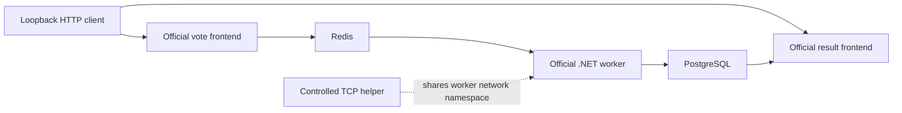

# Phase 2C — Real Docker Example Voting App validation

Validation date: 2026-11-14 UTC. Starting HEAD: `8adbd4a`. No changes were made to the mathematical engine, planner, CollectorManager, DiagnosticAdapter, investigation orchestrator, normalizers, probability catalogue or digital twin. No commit, merge, push, reset or branch switch was performed.

## Result

**InfraSage was exercised against the actual five-service Docker Example Voting App, including its real .NET worker, rather than a generic worker network anchor.** Four opt-in scenarios completed and each restored to a verified healthy application workflow.

The validation exposed important diagnostic limits. All four investigations abstained. Only the healthy case obtained both completed observations. Stopping Redis caused the sample worker to exit, making worker-context connectivity unavailable. The port-disabled and worker-network-interruption cases hit the probe's execution deadline instead of producing reliable socket outcomes. These errors were preserved and did not update beliefs. No calibrated accuracy or measured-energy claim follows from these runs.

The application remains running and healthy for developer inspection:

- Vote UI: <http://127.0.0.1:32769/>
- Result UI: <http://127.0.0.1:32768/>
- Project: `infrasage-voting-phase2c-4db572e8bb`
- Last complete vote-path verification: `2026-11-14T23:27:38.179570+00:00`.

Ports are discovered dynamically; use your generated manifest and actual Docker bindings rather than assuming these numbers on another deployment.

## Initial inspection and provenance

`lab/compose.yaml` was empty. There was no Voting App project. Docker contained only an unrelated stopped hello-world container, which remained unchanged. The existing controlled TCP helper and Redis images were cached; the PostgreSQL and official application images were downloaded with approval.

The lab adapts the official single-replica service layout and published images from [Docker's sample stack](https://github.com/dockersamples/example-voting-app/blob/main/docker-stack.yml). It uses the real vote frontend, worker and result frontend, plus Redis and PostgreSQL. The [sample worker implementation](https://github.com/dockersamples/example-voting-app/blob/main/worker/Program.cs) connects Redis to PostgreSQL; observed worker entrypoint `['dotnet', 'Worker.dll']` and logs confirm the actual application process handled the generated votes.

The immutable registry references observed during deployment are recorded in [lab/voting-app-images.lock.json](../lab/voting-app-images.lock.json). Setup uses these pins rather than silently following future latest tags. Each experiment also records the local image IDs, repository digests and architecture. The published images are not claimed to have been built from the current upstream main commit; the recorded image digests identify the tested artifacts.

### Verified topology



- `redis-tier`: internal bridge joining vote, Redis and worker; service alias redis resolves to the observed Redis address.
- `db-tier`: internal bridge joining worker, PostgreSQL and result; service alias db identifies PostgreSQL.
- `ui-tier`: project-owned UI bridge joining vote/result, permitting loopback-only dynamic published UI ports. Redis and PostgreSQL have no published host ports.
- PostgreSQL data is stored only in a project-owned volume. Redis persistence is disabled.
- The Redis Unix socket `/tmp/redis.sock` permits lab-only listener configuration and restoration without stopping the Redis process.

An initial preflight safely rejected missing published UI ports: this Docker environment did not publish ports for frontends attached solely to internal networks. No fault had been injected. The owned UI bridge was added through the ownership-checked setup refresh; all four recorded experiments then ran successfully. No diagnostic pipeline behavior was altered to accommodate the deployment.

## Implemented files

| File | Purpose |
|---|---|
| `lab/compose.yaml` | Isolated, owned five-service deployment with loopback UI access and Redis Unix socket |
| `lab/voting-app-images.lock.json` | Immutable official image references observed in this validation |
| `lab/voting_app.py` | Ownership validation, healthy workflow checks, scoped fault injection/restoration, trace capture and ground-truth comparison |
| `scripts/setup_voting_app_lab.py` | Explicit creation/refresh of a uniquely named project; discovers actual service/network IDs using Compose labels |
| `scripts/run_voting_app_experiments.py` | Opt-in experiment CLI and restore-only command |
| `tests/test_voting_app_lab.py` | Isolation, manifest/image validation, restoration, trace capture, invalid target and failure-reporting tests |
| `experiments/data/phase2c/*.json` | Four actual labeled experiment records with raw investigation/provenance/state data |
| `.gitignore` | Excludes the machine-local generated identity manifest |
| `docs/PHASE2C_VOTING_APP_VALIDATION.md` | This reproducibility and validation report |

The local `lab/voting-app-manifest.json` is generated, not a portable deployment specification. It contains exact resource IDs, project/token, pinned images, network IDs and last verified healthy endpoints. It must be generated independently on another machine. No unrelated changes were overwritten; the pre-existing Netdata edit and untracked collector audit were preserved.

## Safety and execution contracts

`lab/voting_app.py::VotingAppLab` is an isolated experiment fixture, not a new diagnostic controller or digital-twin integration. Its default investigation callback calls the existing `run_live_investigation()` without changing the engine, policies or stopping rules.

```python
VotingAppLab(client, manifest, helper_image, output_directory,
             *, session=None, investigator=None)
VotingAppLab.run_scenario(scenario, *, allow_fault_injection=False) -> dict
VotingAppLab.verify_baseline(timeout_seconds=75) -> dict
VotingAppLab.restore(before, *, restart_worker) -> dict
```

Before every fault or restoration action, resources must match:

- Full canonical service/container and network IDs in the manifest.
- `org.infrasage.lab=voting-app-phase2c`.
- Exact generated ownership token.
- Exact Compose project and service/network roles.
- Pinned application image identity.

Unknown, missing, duplicate, ambiguous or mismatched identities are rejected before mutation. The runner does not discover a target by arbitrary container name. UI URLs are derived only from a verified owned container's single `127.0.0.1` binding, never supplied as arbitrary external request destinations. Local HTTP verification bypasses environment proxy settings.

Fault scenarios require the literal opt-in CLI flag `--allow-fault-injection`. Invalid scenario/manifest/ownership errors do not authorize mutations. The CLI stops after an experiment or restoration failure instead of injecting the next fault.

The read-only `scripts/demo_live_investigation.py` was not modified. All fault and restoration commands exist only in the lab runner. The runner does not invoke broad Docker prune, kill arbitrary containers, clear external databases, or disconnect non-owned networks. Any loss of Docker access can prevent restoration; such failures are recorded explicitly and require operator recovery.

### Baseline proof

A healthy check requires all five services running, Redis PING through its owned socket and TCP port configured to 6379, HTTP 200 from both frontends, and a unique synthetic vote submitted through the real vote HTTP endpoint. It then queries PostgreSQL for that exact generated voter ID and requires vote a to appear.

This verifies:

```text
actual Flask vote frontend → Redis queue → official .NET worker → PostgreSQL row
```

The result frontend's HTTP page is verified, but its browser rendering and Socket.IO score broadcast are not. Every baseline record explicitly reports `result_scores_stream_verified=false`. This is a stated coverage limit, not a claim that the browser result view was fully tested.

Generated votes intentionally modify only the isolated lab database. They are not production/user data. No database flush is used during restoration. Unique voter IDs prevent previous rows from falsely satisfying a later workflow check.

## Scenarios and restoration

| Scenario | Verified injected condition | Ground-truth mapping | Restoration |
|---|---|---|---|
| healthy | No fault | Healthy control; no healthy-state hypothesis exists in the catalogue | Check unchanged listener/network and verify another full vote |
| redis_stopped | Owned Redis container stopped and inspected as exited | redis_process_stopped | Start owned Redis, restore listener, restart only owned worker, verify full vote |
| redis_port_unavailable | Redis process remains running; CONFIG GET port confirms 0 through Unix socket | Provisionally redis_service_degraded; exact fault is disabled TCP listener | CONFIG SET port 6379 over Unix socket, restart owned worker, verify full vote |
| worker_network_interruption | Only worker removed from owned redis-tier; db-tier remains attached | worker_redis_network_failure | Reconnect original Redis-tier aliases, restart owned worker, verify full vote |

Redis CONFIG commands and Docker state changes are fixed operations, not arbitrary user shell commands. The ground-truth label comes from the injected/verified intervention, never from the Bayesian output. The generic degraded-service hypothesis mapping for the port experiment is an explicit engineering category mapping, not a calibrated equivalence.

The Redis IP is discovered from the actual owned Redis-tier attachment before injection and retained as the investigation endpoint during that scenario. This matches the sample worker's observed cached-IP connection behavior and avoids changing a network fault into a newly unresolved hostname. No fault label is passed to the engine.

Before injection the runner stores service IDs/image IDs, states, network attachments/aliases/IPs, ports, bounded timestamped worker logs and baseline proof. During the fault it records the injected condition and a fresh snapshot. Each result contains the complete existing investigation trace, observations, posterior history, model status, estimated costs and actual elapsed investigation time. Restoration records a new healthy vote proof and final state.

Restoration is attempted in a finally block even after partial injection or investigation failure. A restoration error is saved as `restoration.success=false` with the exact error; later faults do not run. The sample worker can exit on Redis failures, so restarting only the owned worker is part of explicit lab restoration, not an autonomous InfraSage repair decision.

## Reproducible commands

From the repository root, use the existing virtual environment and Docker access. No new Python dependencies are required.

### Create a fresh isolated deployment

```bash
.venv/bin/python scripts/setup_voting_app_lab.py --create
```

The script creates a unique project and refuses to overwrite an existing manifest. It pulls missing pinned official images and discovers actual IDs after Compose starts. `--refresh` reconciles only a manifest- and label-verified existing lab; it is not a command for arbitrary Compose projects.

If the TCP helper is absent, explicitly build it:

```bash
.venv/bin/python scripts/build_tcp_probe_image.py
```

Use its printed full local image ID for HELPER_IMAGE_ID below. The helper build is separate from fault execution and does not install tools in the worker.

### Healthy control and all experiments

```bash
.venv/bin/python scripts/run_voting_app_experiments.py \
  --scenario healthy --helper-image HELPER_IMAGE_ID

.venv/bin/python scripts/run_voting_app_experiments.py \
  --scenario all --allow-fault-injection --helper-image HELPER_IMAGE_ID
```

Any one scenario name can replace all. `--manifest PATH` selects an explicitly owned deployment; `--output PATH` selects the artifact directory. Defaults are the local lab manifest and `experiments/data/phase2c`.

### Explicit recovery

```bash
.venv/bin/python scripts/run_voting_app_experiments.py \
  --restore-only --allow-fault-injection --helper-image HELPER_IMAGE_ID
```

Recovery starts Redis if needed, restores port 6379, reconnects the worker's owned Redis tier if missing, restarts the owned worker, then requires a complete vote-to-database workflow. It never treats an unsuccessful restoration as success. The lab remains deployed after experiments so developers can inspect it; no unrelated resources are stopped or removed.

## Actual results

All four runs selected `redis_runtime_state` followed by `worker_redis_connectivity`, using the existing ratio policy. Every investigation returned ABSTAIN with reason maximum test count reached. No incorrect diagnosis was emitted, but abstention is not counted as a correct diagnosis or an accuracy result.

| Scenario | Runtime evidence | Connectivity evidence | Admitted records | Actual investigation seconds | Restoration |
|---|---|---|---:|---:|---|
| Healthy | completed / running | completed / connected | 2 | 5.686952 | Healthy workflow verified |
| Redis stopped | completed / stopped | unavailable: worker is not running | 1 | 0.059987 | Healthy workflow verified |
| Redis port disabled | completed / running | failed: Docker/helper wait read timeout | 1 | 6.353347 | Healthy workflow verified |
| Worker network interruption | completed / running | failed: Docker/helper wait read timeout | 1 | 6.146613 | Healthy workflow verified |

All posterior sums were 1.0. Every run charged .55 catalogue-estimated J and .37 estimated seconds for two attempts, including unsuccessful acquisitions. No energy meter was used; measured energy is null. Investigation elapsed time excludes setup, fault injection and restoration; those are separately timestamped in the records. Estimated latency is plainly uncalibrated relative to real wall time.

The stopped-Redis scenario illustrates a real application-specific cascade: the worker log records a StackExchange.Redis SocketClosed exception and .NET process exit after Redis stops. A TCP helper cannot reliably enter a stopped worker's network context. The resulting UNAVAILABLE observation is correct execution semantics, not a modeled connection-refused result.

For port-disabled and network-disconnected scenarios, the actual recorded acquisition error was an SDK wait read timeout within the existing probe budget. Helpers were removed successfully. These cases do not establish socket refusal or socket timeout outcomes and do not prove why the helper failed to return under the five-service workload. The pipeline correctly refrained from updating beliefs using them. Replacing these errors with favorable modeled outcomes or increasing confidence thresholds would invalidate the experiment.

### Posterior progression

The following values summarize selected hypotheses; each JSON record contains every hypothesis after every attempted observation.

| Hypothesis | Prior | After runtime running | Healthy after connected | After runtime stopped |
|---|---:|---:|---:|---:|
| redis_process_stopped | .099010 | .006609 | .000494 | .531915 |
| redis_service_degraded | .069307 | .081417 | .006081 | .024823 |
| worker_redis_network_failure | .069307 | .081417 | .006081 | .024823 |
| other_unknown | .089109 | .039651 | .019744 | .177305 |

In the three fault runs the failed/unavailable second attempt left the runtime-only posterior unchanged. The .531915 Redis-stop posterior was below the unchanged .95 confidence threshold, so abstention was expected. In the other two fault runs, running-state evidence alone cannot distinguish a disabled listener from a worker network failure.

The healthy control starts a research investigation despite having no incident trigger and no explicit healthy hypothesis. It tests the integration and false-positive/abstention behavior, not operational incident detection or fault prevalence.

### Durable evidence records

- [Healthy baseline](../experiments/data/phase2c/6292803a03cc41c095c71ef9935b42d5-healthy.json)
- [Redis stopped](../experiments/data/phase2c/b23a839ba77f40fbbd80ba78263fb0cc-redis_stopped.json)
- [Redis running with TCP listener disabled](../experiments/data/phase2c/e73cf9af68094214bac778cb7946dcd3-redis_port_unavailable.json)
- [Worker-to-Redis network interruption](../experiments/data/phase2c/d9e30d5fb4514997a0462f2275fe7e20-worker_network_interruption.json)

`successful_experiment=true` means the fixture recorded a terminal investigation and restored health. It does not mean the system diagnosed the injected cause or collected every diagnostic outcome. The evaluation separately records abstention, correct/incorrect known diagnosis, healthy false positives, evidence completeness and acquisition statuses.

The final independent check found zero remaining TCP probe helpers, verified another vote reached PostgreSQL, and confirmed the unrelated hello-world container remained stopped and unchanged. The five app services, three project networks and owned database volume are intentionally retained in healthy state. Downloaded images also remain cached.

## Regression tests

All test runs use explicit file paths; root-level Docker/network smoke scripts were not imported. New tests use deterministic mocks, not the live lab.

Coverage includes opt-in gating before Docker access, full-ID manifest validation, duplicate/invalid targets, ownership labels, pinned image validation, loopback-only HTTP targets, fixed snapshot capture, partial-fault restoration, investigation failure, cleanup failure reporting, network reconnection, exact synthetic-vote verification, trace export, image-lock restrictions and ground-truth comparison without conflating abstention with diagnosis.

Initial checks passed 27 focused tests and 356 combined tests. Two further isolation/image-lock checks were added; the focused suite passed 29 tests. **Final combined result: 358 passed in 57.64s — all 329 existing tests plus 29 new tests.**

```bash
.venv/bin/python -m pytest -q \
  tests/test_engine.py tests/test_validation.py \
  tests/test_catalogue_loader.py tests/test_normalizer.py \
  tests/test_real_observation_integration.py \
  tests/test_collector_manager.py tests/test_diagnostic_adapter.py \
  tests/test_worker_redis_connectivity.py tests/test_live_investigation.py \
  tests/test_voting_app_lab.py
```

SHA256 comparison against task-start snapshots confirmed that every pre-existing backend Python module and all catalogue files are unchanged. The lab work does not modify the diagnostic contracts to obtain passing tests or more favorable live outcomes.

## Limits and next steps

- One run per scenario on one machine/image set is descriptive validation, not a statistical accuracy, calibration or generalization study.
- All likelihoods and costs remain synthetic. Deliberately balanced fault injection cannot estimate operational priors.
- Three fault cases lack a completed second diagnostic; investigate worker lifecycle and helper acquisition/deadline behavior under the real app before claiming broader diagnostic coverage.
- Add verified worker runtime evidence and Redis service-level checks in a separately scoped phase to distinguish acquisition availability from endpoint failure.
- Preserve causal labels and independent repetitions when collecting calibration data. Dependency between runtime state, connectivity and worker exit still matters.
- The result page's score broadcast/browser rendering remains unverified even though the actual vote-to-PostgreSQL path and both HTTP pages succeeded.
- No digital-twin manager, repair validation, probability estimator or automatic remediation was integrated.

The milestone establishes a real Voting App testbed, labeled controlled interventions, honest evidence failures, reproducible traces and verified restoration. It does not establish production-ready root-cause diagnosis.
